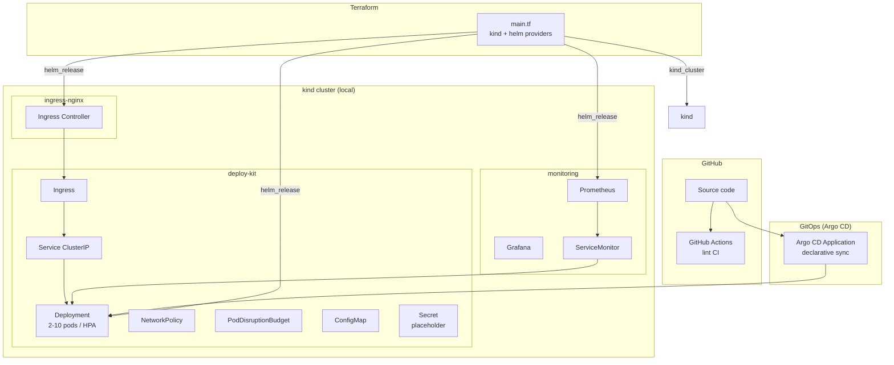

# deploy-kit

> Reference Kubernetes + Terraform + GitOps deployment — a production-grade stack that runs 100 % free on a local [kind](https://kind.sigs.k8s.io) cluster.

[](https://github.com/chirag127/deploy-kit/actions/workflows/lint.yaml)
[](LICENSE)
[](https://github.com/chirag127/deploy-kit/commits)
[](https://github.com/chirag127/deploy-kit/stargazers)
[](https://kubernetes.io)
[](https://terraform.io)

## What it is / why it exists

A tiny **FastAPI "hello world"** service is easy. Deploying it the way a real production service should be deployed — with autoscaling, disruption budgets, network policy, non-root containers, full probes, and observability — is where most reference repos stop short. deploy-kit is that full deployment, packaged three ways (Kustomize, Helm, Terraform-managed Helm) and wired to Prometheus/Grafana and Argo CD, so you can stand the whole thing up on a laptop with `make up` and pay nothing.

```bash
make up          # kind cluster + terraform apply (nginx-ingress + Prometheus/Grafana + app)
```

## Links

- Repo: [github.com/chirag127/deploy-kit](https://github.com/chirag127/deploy-kit)

## ⭐ Star this repo

If this is useful, please ⭐ star the repo — it helps others find it.

## What's inside

A **FastAPI "hello world"** service (`/`, `/healthz`, `/readyz`, `/metrics`) deployed with every production-grade Kubernetes primitive in place — HPA, PDB, NetworkPolicy, non-root securityContext, readiness/liveness/startup probes — then packaged three ways: raw Kustomize manifests, a Helm chart, and Terraform-managed Helm releases.



## Features

- FastAPI service with health (`/healthz`), readiness (`/readyz`), and Prometheus (`/metrics`) endpoints.
- Full production K8s primitives: HPA (2–10 pods), PodDisruptionBudget, NetworkPolicy, non-root securityContext, readiness/liveness/startup probes.
- Packaged three ways — Kustomize (base + dev/prod overlays), a Helm chart, and Terraform-managed Helm releases.
- ingress-nginx + kube-prometheus-stack (Prometheus, Grafana, Alertmanager) bundled.
- Argo CD GitOps manifests (Kustomize + Helm variants) for declarative sync.
- One-command bring-up/tear-down via `make up` / `make down` — no cloud credentials, no cost.
- Multi-stage Dockerfile; lint CI (terraform fmt/validate, helm lint, kustomize build, yamllint).

## Tech stack

- **Kubernetes 1.32** (local via **kind**)
- **Terraform 1.5+** — `tehcyx/kind`, `hashicorp/helm`, `hashicorp/kubernetes` providers
- **Helm 3** + **Kustomize 5** for packaging
- **FastAPI** service + multi-stage **Docker** build
- **Prometheus / Grafana / Alertmanager** (kube-prometheus-stack) for observability
- **Argo CD** for GitOps
- **GitHub Actions** for lint CI

## Layers

| Layer | Path | Purpose |
|---|---|---|
| App | `app/` | FastAPI service + multi-stage Dockerfile |
| Kustomize base | `k8s/base/` | All Kubernetes objects, environment-agnostic |
| Dev overlay | `k8s/overlays/dev/` | Reduced replicas + resources for local |
| Prod overlay | `k8s/overlays/prod/` | 3+ replicas, TLS, stricter limits |
| Helm chart | `charts/deploy-kit-app/` | Alternative packaging — same app, fully templated |
| Terraform | `terraform/` | Provisions kind cluster + installs everything via Helm |
| GitOps | `gitops/` | Argo CD Application manifests (Kustomize + Helm variants) |
| Observability | `observability/` | kube-prometheus-stack values + Grafana dashboard JSON |
| CI | `.github/workflows/` | lint (tf/helm/kustomize/yamllint/docker) |

**Why both Kustomize and Helm?**
Kustomize is native to `kubectl` and `git`-diffable with zero abstraction; Helm is the ecosystem standard for distribution. Argo CD speaks both. Terraform uses the Helm releases for initial cluster bootstrap.

## Prerequisites

| Tool | Min version | Install |
|---|---|---|
| Docker Desktop | 4.x | https://docs.docker.com/desktop/ |
| kind | 0.24 | `brew install kind` / `choco install kind` |
| kubectl | 1.32 | `brew install kubectl` |
| terraform | 1.5 | `brew tap hashicorp/tap && brew install hashicorp/tap/terraform` |
| helm | 3.x | `brew install helm` |
| kustomize | 5.x | bundled in kubectl |

## Quick start

```bash
# 1. clone
git clone https://github.com/chirag127/deploy-kit.git
cd deploy-kit

# 2. spin up everything
make up

# 3. test the app (add to /etc/hosts: 127.0.0.1 deploy-kit.local)
curl http://localhost:8080/healthz
curl http://localhost:8080/metrics

# 4. open Grafana
kubectl port-forward -n monitoring svc/kube-prometheus-stack-grafana 3000:80
# http://localhost:3000  admin/admin

# 5. optional — install Argo CD + sync the app declaratively
make argocd-install

# 6. tear down
make down
```

## Make targets

| Target | What it does |
|---|---|
| `make up` | `terraform init` + `apply` — creates the kind cluster and deploys the full stack |
| `make down` | `terraform destroy` — tears down the cluster + state |
| `make deploy` | `kubectl apply -k` the dev overlay directly (no Terraform) |
| `make kustomize-build` | Render base + dev + prod overlays to stdout (no cluster needed) |
| `make build-app` | Build the app Docker image locally |
| `make load-image` | Build + `kind load` the image into the cluster |
| `make argocd-install` | Install Argo CD and apply the Application manifest |
| `make lint` | Run all linters (`lint-tf`, `lint-helm`, `lint-kustomize`, `lint-yaml`) |
| `make lint-tf` | `terraform fmt -check` + `validate` |
| `make lint-helm` | `helm lint` the chart |
| `make lint-kustomize` | `kubectl kustomize` renders all overlays |
| `make lint-yaml` | `yamllint` across `k8s/ charts/ gitops/ observability/` |
| `make help` | List all targets |

## Kustomize overlays

```bash
kustomize build k8s/overlays/dev   | kubectl apply -f -
kustomize build k8s/overlays/prod  | kubectl apply -f -
```

The prod overlay adds TLS ingress, 3 base replicas, and tighter resource limits; the dev overlay reduces to 1 replica and relaxed limits.

## Terraform-only bring-up

```bash
cd terraform
terraform init
terraform apply          # creates kind cluster + deploys everything
terraform destroy        # tears it all down
```

All providers are free: `tehcyx/kind` (local cluster), `hashicorp/helm`, `hashicorp/kubernetes`. No cloud credentials required.

## Observability

- **Prometheus** scrapes `/metrics` every 15 s via the `ServiceMonitor`.
- **Grafana** dashboard (`observability/grafana-dashboard.json`) shows: request rate, error rate, p50/p95/p99 latency, CPU/memory per pod, HPA replica count.
- **Alertmanager** bundled; add alert rules to `terraform/values/kube-prometheus-stack.yaml`.

## Security

- **No real secrets in this repo.** The `Secret` objects contain `REPLACE_ME` placeholders. For real deployments use either:
  - **Sealed Secrets** (`kubeseal`) — encrypted at rest in git, decryptable only by the cluster controller.
  - **External Secrets Operator** — syncs from Vault / AWS SSM / GCP Secret Manager.
- Containers run non-root with a hardened `securityContext`; NetworkPolicy restricts pod ingress/egress.

## Resume keywords legitimately backed

`Kubernetes` · `Kustomize` · `Helm` · `Terraform / IaC` · `Argo CD / GitOps` · `Prometheus / Grafana / observability` · `HPA (HorizontalPodAutoscaler)` · `NetworkPolicy` · `PodDisruptionBudget` · `multi-stage Docker` · `GitHub Actions CI/CD` · `kind (local K8s)` · `securityContext / non-root containers` · `ServiceMonitor / kube-prometheus-stack`

## Part of the oriz family

deploy-kit is one of ~80 sites and tools in the **oriz** family. See [blog.oriz.in](https://blog.oriz.in) for the rest.

## Contributing

Issues and PRs welcome. Conventional commits are the changelog.

## License

MIT © Chirag Singhal. See [LICENSE](./LICENSE).

## Author

Chirag Singhal · [chirag@oriz.in](mailto:chirag@oriz.in)

## Status / roadmap

**Stable** reference deployment. Runs entirely on a free local kind cluster — no cloud spend.
