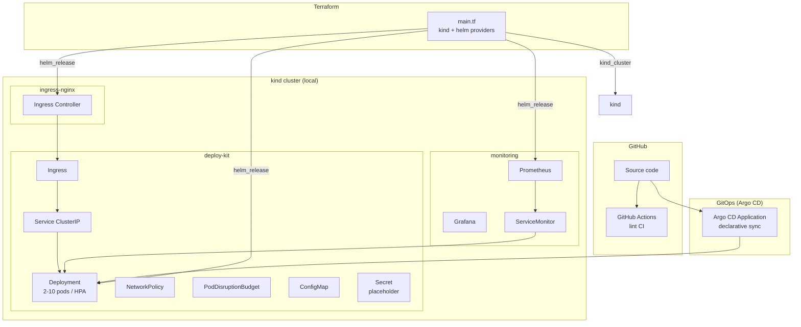

# deploy-kit

[](https://github.com/chirag127/deploy-kit/actions/workflows/lint.yaml)
[](LICENSE)
[](https://kubernetes.io)
[](https://terraform.io)

Reference Kubernetes + Terraform + GitOps deployment — runs 100 % free on a local [kind](https://kind.sigs.k8s.io) cluster.

```bash
make up          # kind cluster + terraform apply (nginx-ingress + Prometheus/Grafana + app)
```

---

## What's inside

A **FastAPI "hello world"** service (`/`, `/healthz`, `/readyz`, `/metrics`) deployed with every production-grade Kubernetes primitive in place — HPA, PDB, NetworkPolicy, non-root securityContext, readiness/liveness/startup probes — then packaged three ways: raw Kustomize manifests, a Helm chart, and Terraform-managed Helm releases.



---

## Layers

| Layer | Path | Purpose |
|---|---|---|
| App | `app/` | FastAPI service + multi-stage Dockerfile |
| Kustomize base | `k8s/base/` | All Kubernetes objects, environment-agnostic |
| Dev overlay | `k8s/overlays/dev/` | Reduced replicas + resources for local |
| Prod overlay | `k8s/overlays/prod/` | 3+ replicas, TLS, stricter limits |
| Helm chart | `charts/deploy-kit-app/` | Alternative packaging — same app, fully templated |
| Terraform | `terraform/` | Provisions kind cluster + installs everything via Helm |
| GitOps | `gitops/` | Argo CD Application manifests (Kustomize + Helm variants) |
| Observability | `observability/` | kube-prometheus-stack values + Grafana dashboard JSON |
| CI | `.github/workflows/` | lint (tf/helm/kustomize/yamllint/docker) + release |

**Why both Kustomize and Helm?**
Kustomize is native to `kubectl` and `git`-diffable with zero abstraction; Helm is the ecosystem standard for distribution. Argo CD speaks both. Terraform uses the Helm releases for initial cluster bootstrap.

---

## Prerequisites

| Tool | Min version | Install |
|---|---|---|
| Docker Desktop | 4.x | https://docs.docker.com/desktop/ |
| kind | 0.24 | `brew install kind` / `choco install kind` |
| kubectl | 1.32 | `brew install kubectl` |
| terraform | 1.5 | `brew tap hashicorp/tap && brew install hashicorp/tap/terraform` |
| helm | 3.x | `brew install helm` |
| kustomize | 5.x | bundled in kubectl |

---

## Quick start

```bash
# 1. clone
git clone https://github.com/chirag127/deploy-kit.git
cd deploy-kit

# 2. spin up everything
make up

# 3. test the app (add to /etc/hosts: 127.0.0.1 deploy-kit.local)
curl http://localhost:8080/healthz
curl http://localhost:8080/metrics

# 4. open Grafana
kubectl port-forward -n monitoring svc/kube-prometheus-stack-grafana 3000:80
# http://localhost:3000  admin/admin

# 5. optional — install Argo CD + sync the app declaratively
make argocd-install

# 6. tear down
make down
```

---

## Secrets pattern

No real secrets in this repo. The `Secret` objects contain `REPLACE_ME` placeholders. For real deployments use either:

- **Sealed Secrets** (`kubeseal`) — encrypted at rest in git, decryptable only by the cluster controller.
- **External Secrets Operator** — syncs from Vault / AWS SSM / GCP Secret Manager.

---

## Observability

- **Prometheus** scrapes `/metrics` every 15 s via the `ServiceMonitor`.
- **Grafana** dashboard (`observability/grafana-dashboard.json`) shows: request rate, error rate, p50/p95/p99 latency, CPU/memory per pod, HPA replica count.
- **Alertmanager** bundled; add alert rules to `terraform/values/kube-prometheus-stack.yaml`.

---

## Kustomize overlays

```
kustomize build k8s/overlays/dev   | kubectl apply -f -
kustomize build k8s/overlays/prod  | kubectl apply -f -
```

The prod overlay adds TLS ingress, 3 base replicas, and tighter resource limits; the dev overlay reduces to 1 replica and relaxed limits.

---

## Terraform-only bring-up

```bash
cd terraform
terraform init
terraform apply          # creates kind cluster + deploys everything
terraform destroy        # tears it all down
```

All providers are free: `tehcyx/kind` (local cluster), `hashicorp/helm`, `hashicorp/kubernetes`. No cloud credentials required.

---

## Resume keywords legitimately backed

`Kubernetes` · `Kustomize` · `Helm` · `Terraform / IaC` · `Argo CD / GitOps` · `Prometheus / Grafana / observability` · `HPA (HorizontalPodAutoscaler)` · `NetworkPolicy` · `PodDisruptionBudget` · `multi-stage Docker` · `GitHub Actions CI/CD` · `kind (local K8s)` · `securityContext / non-root containers` · `ServiceMonitor / kube-prometheus-stack`

---

## License

MIT © 2026 Chirag Singhal
